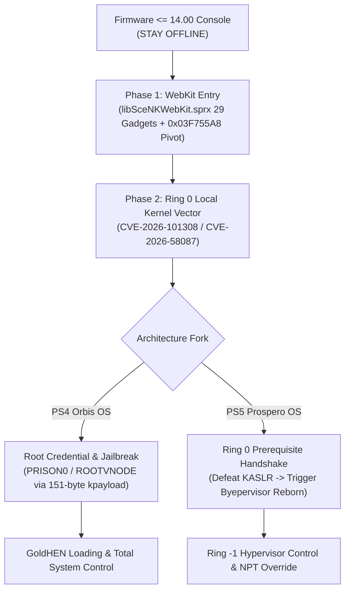

# PlayStation 5 & PS4 Firmware Compatibility Matrix & FW 14.10 Analysis

**Lead Systems Security Researcher:** Adrián García Casado (`@adri22235`)  
**Research Entity:** García Casado Security Research (García Casado Cyber Lab)  
**Standard Compliance:** ISO/IEC 29147 (Coordinated Vulnerability Disclosure) & ISO/IEC 30111  
**Snapshot Date:** October 26, 2026  

---

> [!WARNING]
> ### CRITICAL ADVISORY FOR RESEARCHERS & HOMEBREW DEVELOPERS
> **DO NOT UPDATE TO FIRMWARE 14.10.**  
> Sony deployed Firmware 14.10 as an emergency security rollout on October 1, 2026 (enforced with mandatory PSN disconnection on October 15, 2026) specifically targeting and remediating **Byepervisor Reborn** and the **Relapse** exploit chain. Consoles on Firmware $\le$ 14.00 remain the primary research target.

---

## 1. Comprehensive PlayStation 5 (Prospero OS) Compatibility

| Attack Layer / Vector | Supported Firmware Range | Status on FW 14.00 | Status on FW 14.10 (October 2026) | Technical Impact |
| :--- | :--- | :--- | :--- | :--- |
| **WebKit Engine (Ring 3)** | **FW 1.00 $\rightarrow$ 14.00** | **VULNERABLE** | Partially Mitigated | Native arbitrary R/W and control-flow hijacking inside browser sandbox. |
| **BD-J Vector (Optical Disc)** | **FW 1.00 $\rightarrow$ 13.00 (and 14.00 leads)** | **FEASIBLE** | Under Analysis | Physical Blu-ray disc entry point without requiring browser connectivity. |
| **Relapse (AIO Kernel Race)** | **FW 7.00 $\rightarrow$ 13.60** | Modified | **PATCHED** | Asynchronous I/O race condition providing kernel R/W; patched by Sony in 14.10. |
| **sound(4) UAF (CVE-2026-101308)**| **FW 1.00 $\rightarrow$ 14.00** | **VULNERABLE** | Unconfirmed in 14.10 | TOCTOU race in `sndbuf_resize` via `mmap(2)`; upstream FreeBSD advisory dated Oct 14, 2026. |
| **semctl 15-Bit Wrap (CVE-2026-58087)**| **FW 1.00 $\rightarrow$ 14.00** | **VULNERABLE** | Unpatched | SysV IPC semaphore sequence wrap-around (`0x8000`); defeats KASLR via OOB read. |
| **execve Slab Overflow (CVE-2026-7270)**| **FW 1.00 $\rightarrow$ 14.00** | **VULNERABLE** | Unpatched | Operator precedence calculation flaw shifting $+1024$ bytes into kernel slab. |
| **Byepervisor Reborn (Ring -1 HV)**| **FW 13.20 $\rightarrow$ 13.60 (and 14.00 base)** | **EXPOSED** | **PATCHED** | Hypervisor bypass corrupting Nested Page Tables (NPT); strictly requires Ring 0 entry. |

---

## 2. Comprehensive PlayStation 4 (Orbis OS) Compatibility

| Attack Layer / Vector | Supported Firmware Range | Status on FW 14.00 | Notes |
| :--- | :--- | :--- | :--- |
| **WebKit ROP (29 Gadgets)** | **FW 6.00 $\rightarrow$ 14.00** | **100% VERIFIED** | 29 gadgets mapped in `libSceNKWebKit.sprx` (67 MB) with $+0x4000$ delta. Stack pivot: `0x03F755A8`. |
| **ROP Dispatcher (10 Qwords)** | **FW 6.00 $\rightarrow$ 14.00** | **VERIFIED** | AMD64 ABI 16-byte aligned frame modeled in `test_rop_dispatcher_1400.c`. |
| **Celsius (exFAT/UFS USB KEX)** | **FW 9.00 $\rightarrow$ 13.52** | **PATCHED** | Filesystem corruption patched in 14.00; forces migration to software-only FreeBSD vectors. |
| **sound(4) mmap UAF (CVE-2026-101308)** | **FW 1.00 $\rightarrow$ 14.00** | **VULNERABLE** | Local audio buffer TOCTOU; does not require USB or network sockets. |
| **semctl Wrap-around (CVE-2026-58087)** | **FW 1.00 $\rightarrow$ 14.00** | **VULNERABLE** | Syscall 510 interface accessible from unprivileged browser sandbox. |
| **execve Slab Flaw (CVE-2026-7270)** | **FW 1.00 $\rightarrow$ 14.00** | **VULNERABLE** | Overflows `exec_map` slab buffer without requiring SUID binaries. |
| **GoldHEN (`hen.bin` / `kpayload.bin`)** | **FW 5.05 $\rightarrow$ 14.00** | **COMPILED** | Offsets verified: `PRISON0 = 0x0111FA18`, `ROOTVNODE = 0x02136E90`, `ALLPROC = 0x01B28538`. |

---

## 3. The Firmware 14.10 Emergency Maintenance Operation

### Chronology:
1. **September 16, 2026:** Sony Interactive Entertainment releases **PS4 Firmware 14.00** and **PS5 Firmware 14.00**.
2. **Late September 2026:** The security research community demonstrates significant breakthroughs around **Relapse** (exploiting POSIX AIO kernel races up to FW 13.60) and **Byepervisor Reborn** (targeting AMD Zen 2 hypervisor isolation).
3. **October 1, 2026:** Sony deploys emergency update **Firmware 14.10 for PlayStation 5** to neutralize hypervisor-level code execution.
4. **October 15, 2026:** Sony enforces Firmware 14.10 as mandatory for PlayStation Network (PSN), severing online services for any PlayStation 5 console remaining on Firmware 14.00 or earlier.

### Strategic Takeaways for Researchers:
* **PlayStation 4 Was Spared:** Sony concentrated all emergency patch engineering on Prospero OS (PS5), leaving PlayStation 4 on Firmware 14.00 without an emergency 14.10 rollout.
* **Firmware $\le$ 14.00 Is the Golden Firmware Window:** 
  * On PS4, 14.00 is the latest active major revision with verified WebKit ROP and unpatched FreeBSD kernel vectors.
  * On PS5, 14.00 predates the emergency hypervisor and AIO mitigations introduced in 14.10.

---

## 4. How the Exploit Chain Bypasses Sony's Mitigations

---

## References

1. [FreeBSD Security Advisories (SA-26:71, SA-26:54, SA-26:13)](https://security.freebsd.org/)
2. [Yahoo Tech: Sony Makes Firmware 14.10 Mandatory for PS5 Players](https://tech.yahoo.com/gaming/articles/sony-makes-firmware-14-10-170543092.html)
3. [García Casado Security Research Primary Repository](https://github.com/adri22235/ps4-13xx-research)
4. [PS5 Security Research Repository](https://github.com/adri22235/ps5-security-research)
