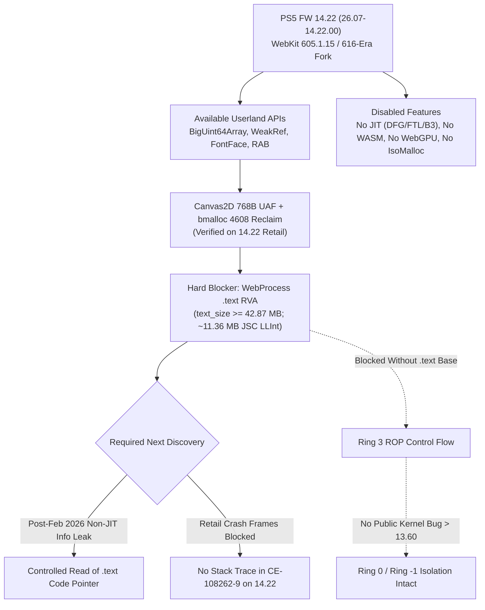

# PlayStation 5 Firmware 14.22 (26.07-14.22.00) Security Dossier & Compatibility Matrix

**Lead Systems Security Researcher:** Adrián García Casado (`@adri22235`)  
**Research Entity:** García Casado Security Research (García Casado Cyber Lab)  
**Standard Compliance:** ISO/IEC 29147 (Coordinated Vulnerability Disclosure) & ISO/IEC 30111  
**Snapshot Date:** November 14, 2026  

---

> [!IMPORTANT]
> ### TARGET BOUNDARY & COMPLIANCE NOTICE (FW 14.22)
> Sony Interactive Entertainment released **PlayStation 5 System Software Update `26.07-14.22.00` (FW 14.22)** on **November 2, 2026** (~1.27 GB; official changelog: *"We've made some security fixes to the system software"*).  
> As of November 14, 2026, **no public full kernel exploit or jailbreak exists for FW 14.20 or FW 14.22** (public full chains remain restricted to **FW $\le$ 13.60**). Research on **FW 14.22** focuses strictly on defensive memory-safety verification, WebKit `605.1.15 / 616`-era allocator geometry, and upstream FreeBSD patch auditing under **ISO/IEC 29147** and **ISO/IEC 30111**.

---

## 1. Firmware Evolution Timeline (`14.00` $\rightarrow$ `14.22`)

| Firmware Version | Release Date | Primary Security / Patch Focus | Research & Attack Surface Status |
| :--- | :--- | :--- | :--- |
| **14.00** | Sept 16, 2026 | Major branch point; WebKit `605.1.15` (internal `616` fork). | Baseline `14.xx` WebKit & FreeBSD target window. |
| **14.10** | Oct 1, 2026 *(PSN req. Oct 15)* | Emergency maintenance hardening **Byepervisor Reborn** / AIO paths. | Lua kernel `syscall`/`ioctl` TOCTOU surface exhausted across 2,682 probes; live research pivots to WebKit (`Canvas2D` + `FontFace`) userland R/W and WebProcess `.text` base discovery. |
| **14.20** | Oct 21, 2026 | Explicitly patched **`aio_multi_delete` ("Prolapse" / syscall 662)** TOCTOU race. | Confirmed patched in kernel; WebKit `Canvas2D` UAF (`CVE-2026-43720`) verified functional (3/3 cold boots on PS5 Pro); post-14.20 remote Lua/FTP userland PoCs demonstrated publicly. |
| **14.22 (`26.07-14.22.00`)** | Nov 2, 2026 | System software security fixes tightening post-14.20 userland entry vectors ahead of late-2026 flagship launches. | **WebKit `605.1.15 / 616` branch preserved:** independent retail 14.22 verification confirms `Canvas2D` alias R/W still triggers (`bmalloc`), while kernel remains unexploited publicly and crash reports emit zero stack frames. |

---

## 2. Attack Surface & Compatibility Matrix on FW 14.22

| Layer / Component | Status on FW 14.22 | Technical Verification & Constraints |
| :--- | :--- | :--- |
| **WebKit Engine (`CanvasRenderingContext2D` UAF)** | **REPRODUCIBLE (Ring 3 Alias R/W)** | Confirmed on **14.22 retail**: shared WebKit `605.1.15` / internal `616` branch point preserves the 768 B `CanvasRenderingContext2D` slot and `ArrayBuffer(768)` reclaim geometry. Blocked before arbitrary code execution by the missing WebProcess `.text` base RVA. |
| **`FontFace` / `CSSFontFace` UAF Chain** | **ABI ALIGNED (Ring 3)** | Itanium C++ ABI layout and 192 B `CSSFontFace` slot apply across `14.00–14.22`. Secondary `CSSFontFace::Client` vtable (`+0x20`) exhibits Identical Code Folding (`s2 == s4 == s5`), leaving `s3` (`fontStateChanged`) as the unique discriminating callback. |
| **JavaScriptCore Tiering & WebAssembly** | **LLInt-ONLY / DISABLED** | `OptionsPlayStation.cmake` builds with `ENABLE_JIT=0`, `ENABLE_DFG_JIT=0`, `ENABLE_FTL_JIT=0`, `ENABLE_B3_JIT=0`, `ENABLE_WEBASSEMBLY=0`, `USE_ISO_MALLOC=0`, and `libpas=OFF`. |
| **Error-History / Telemetry Crash Oracle** | **HARDENED (Zero Frames)** | Generic fault error codes (`CE-108262-9`) on both **14.10** and **14.22 retail** strip module-relative backtrace frames, blocking passive ASLR slides via crash dumps. |
| **`aio_multi_delete` (Syscall 662 / Prolapse)** | **PATCHED ($\ge$ 14.10/14.20)** | TOCTOU double-free race remediated by Sony in `14.20`; unavailable on `14.22`. |
| **Userland Game/Lua Loaders** | **TIGHTENED / UNVERIFIED** | `14.22` rolled out directly following public post-`14.20` userland loader PoCs; requires re-verification per loader entrypoint. |
| **Hypervisor (Ring -1) / Public Full Jailbreak** | **UNAVAILABLE ($>$ 13.60)** | No public Ring 0 primitive or hypervisor bypass exists on `14.22`. |

---

## 3. WebKit 605.1.15 / 616-Era Allocator & Object Geometry (`14.00` – `14.22`)

Because `USE_ISO_MALLOC` and `libpas` are compiled **OFF**, `WebCore` and `JSC` objects allocate out of standard **`bmalloc`** pools (`Source/bmalloc/bmalloc/Sizes.h`). Same-type or size-class-matched reclaim sprays are mandatory—cross-class sprays never overlap.

### 3.1 `bmalloc` Size-Class Stepping Law
`bmalloc` doubles class granularity per power-of-two magnitude tier:

| Size Range (Bytes) | Step Size | Resulting Allocator Classes | Target Objects in FW 14.22 Research |
| :--- | :--- | :--- | :--- |
| `[512, 1024)` | `64 B` | `512, 576, 640, 704, 768, 832, 896, 960` | **`768 B`**: `CanvasRenderingContext2D` slot (`ArrayBuffer(768)` reclaim); `192 B` tier handles `CSSFontFace`. |
| `[1024, 2048)` | `128 B` | `1024, 1152, 1280, ..., 1920` | General DOM / backing buffers. |
| `[2048, 4096)` | `256 B` | `2048, 2304, ..., 3840, 4096` | Intermediate string / state buffers. |
| `[4096, 8192)` | **`512 B`** | **`4608, 5120, 5632, 6144, 6656, 7168, 7680, 8192`** | **`4608 B`**: Monolithic class for out-of-line `CanvasRenderingContext2D::m_stateStack` (11 states). |

> [!WARNING]
> **`4352` Is NOT a `bmalloc` Size Class:** Because step granularity above `4096 B` jumps to `512 B`, any allocation in `(4096, 4608]` rounds strictly up to **`4608`**. Sprays assuming `4352` or legacy `7424 B` (`7680` class) miss the active `m_stateStack` buffer slot.

### 3.2 `CanvasRenderingContext2D` & `Vector<State, 1> m_stateStack`
* **Vector Header (`wtf/Vector.h`):** Places capacity before size:
  * `+0x70`: `m_stateStack.m_buffer` (`void*`) — inline fresh state satisfies **`m_buffer == ctxVA + 0x80`** (self-pointing discriminator).
  * `+0x78`: `m_stateStack.m_capacity` (`uint32_t`, initial inline = `1`).
  * `+0x7C`: `m_stateStack.m_size` (`uint32_t`).
  * `+0x80`: Inline `State[0]` (`~376–408 B`).
* **Realized Expansion Law:** Lazy `save()` increments `m_unrealizedSaveCount`; property setters force vector growth via:
  $$\text{newCapacity} = \text{capacity} + \left\lfloor\frac{\text{capacity}}{4}\right\rfloor + 1$$
  Sequence across realized saves: $1 \rightarrow 2 \rightarrow 3 \rightarrow 4 \rightarrow 6 \rightarrow 8 \rightarrow \mathbf{11}$.  
  At 11 states, $11 \times (376\text{–}408\text{ B}) \approx 4136\text{–}4488\text{ B}$, landing deterministically in **`bmalloc` class `4608`**.

### 3.3 `FontFace` Itanium C++ ABI & Tagged Weak Pointers
Verified against Safari 17.0 / `616`-era inheritance (`FontFace : RefCounted<FontFace>, ActiveDOMObject, CSSFontFace::Client`):

| Offset | Member / Subobject | Size | Security & Analysis Role |
| :--- | :--- | :--- | :--- |
| `+0x00` | `ActiveDOMObject` Primary `vptr` | `8 B` | Primary dynamic base (`ContextDestructionObserver`). |
| `+0x08` | `ScriptExecutionContext*` (`Document*`) | `8 B` | Context back-pointer. |
| `+0x10` | `m_pendingActivityInstanceCount` | `8 B` | Scalar activity counter (`0` or `1`). |
| `+0x18` | `RefCountedBase::m_refCount` | `4 B (+4 pad)` | Non-polymorphic refcount allocated after `ActiveDOMObject`. |
| `+0x20` | `CSSFontFace::Client` Secondary `vptr` | `8 B` | Client callback vtable (`s2==s4==s5` ICF `ret`; `s3` `fontStateChanged` is unique). |
| `+0x28` | `CompactRefPtrTuple<WeakPtrImpl, uint16_t>` | `8 B` | Tagged qword `impl* \| (type << 48)`; requires **`val & 0x0000FFFFFFFFFFFFULL`** mask. |
| `+0x30` | `Ref<CSSFontFace> m_backing` | `8 B` | Strong reference to `192 B` backing `CSSFontFace` (`+0x58` `m_clients`, `+0x68` `m_wrapper`, `+0x90` `Timer vptr`). |

---

## 4. The WebProcess `.text` Base Blocker & Pipeline Topology

### Cherry-Pick Gap Audit (Why Certain Safari 26.x/27.x CVEs Do Not Apply)
* **Dead on PS5 (`14.10–14.22`):** WebGPU OOB reads (`CVE-2026-112699`, `CVE-2026-112680`) cannot be reached because WebGPU is unimplemented on PlayStation's WebKit fork.
* **Config-Silent (`14.10–14.22`):** `CVE-2026-43740` (YARR JIT Unicode backreference UAF, Bugzilla `308046`) compiles out cleanly when `ENABLE_JIT=0`.
* **Active Research Need:** Non-JIT, non-WebGPU **process memory disclosure (`CWE-125` / `CWE-416`)** or `FontFace::Client` vtable-relative binary anchor capable of resolving the unknown `text_size` (`>= 42.87 MB`) link-time constant without JIT codegen.

---

## 5. Verification Suite in This Repository

* Run [`tests/test_webkit_1422_geometry.c`](tests/test_webkit_1422_geometry.c) via `make -C tests run` to verify:
  1. `bmalloc` size-class rounding and exclusion of `4352`.
  2. `Vector<State, 1>` expansion progression (`1 -> 2 -> 3 -> 4 -> 6 -> 8 -> 11`) mapping `[4136, 4488]` bytes to **`4608`**.
  3. `CanvasRenderingContext2D` (`+0x70..+0x80`) and `FontFace` Itanium ABI (`+0x00..+0x30`) layouts plus 48-bit tagged pointer unmasking.
* Open [`exploit_ps5.html`](exploit_ps5.html) in a target WebProcess environment to execute live JS runtime capability probes (`BigUint64Array`, `WeakRef`, `FontFace`, `ArrayBuffer.prototype.resize`, `WebAssembly`, `SharedArrayBuffer`) and `bmalloc 4608` geometry diagnostics.

---

## References
1. [`FIRMWARE_COMPATIBILITY_1410.md`](FIRMWARE_COMPATIBILITY_1410.md) — Prior baseline covering `14.00` vs `14.10` and upstream FreeBSD vectors.
2. [`PROSPERO_ARCHITECTURE.md`](PROSPERO_ARCHITECTURE.md) — AMD Zen 2 Ring 3 / Ring 0 / Ring -1 SVM hypervisor separation.
3. [`KERNEL_VECTORS_PS5.md`](KERNEL_VECTORS_PS5.md) — Upstream FreeBSD subsystem analysis (`sound(4)`, `sysv_sem`, `kern_exec`).
4. PlayStation 5 System Software Update `26.07-14.22.00` (November 2, 2026).
