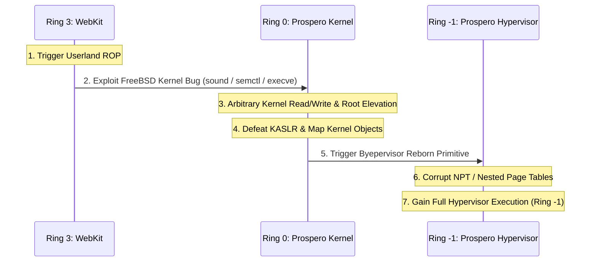

# Prospero OS Architecture & Hypervisor Security Analysis

**Lead Researcher:** Adrián García Casado (`@adri22235`)  
**Research Entity:** García Casado Security Research (García Casado Cyber Lab)  
**Standard:** ISO/IEC 29147 (Coordinated Vulnerability Disclosure)  

---

## 1. Overview of the Prospero Security Architecture

The PlayStation 5 operates on **Prospero OS**, which incorporates hardware-level protections enforced by the **AMD Zen 2** microarchitecture. Unlike the PlayStation 4, where achieving Ring 0 control effectively grants total supervisor capability over the hardware, the PS5 enforces an additional hypervisor barrier (**Ring -1**).

### Security Hierarchy:

1. **Userland (Ring 3):**
   * Processes run with unprivileged capabilities (`uid != 0`).
   * Browser process (`WebKit`) is confined to a tight sandbox.
   * Enforces hardware W^X: writable pages cannot be executed.
   * SMEP (Supervisor Mode Execution Prevention) prevents Ring 0 from executing userland code.
   * SMAP (Supervisor Mode Access Prevention) prevents Ring 0 from inadvertently dereferencing userland pointers.

2. **Prospero Kernel (Ring 0):**
   * Manages processes, virtual memory (`vm_map`), scheduling, and drivers.
   * Derived from FreeBSD (hybrid BSD 11/12 tree).
   * Kernel pages are protected by hardware page tables, but supervisor mode permissions are governed by the Hypervisor.

3. **Prospero Hypervisor (Ring -1 / AMD SVM):**
   * Controls Nested Page Tables (NPT / SLAT).
   * Restricts write permissions to kernel code pages even if Ring 0 attempts to modify `CR0.WP`.
   * Enforces code signing and integrity over kernel `.text`.

---

## 2. The Ring 0 to Ring -1 Transition Pipeline

To execute homebrew, patch security checks, or inspect low-level system states on the PlayStation 5, a researcher must cross two consecutive security boundaries:

### Why Ring 0 Is the Mandatory Prerequisite:
* A hypervisor vulnerability (such as *Byepervisor* or *Byepervisor Reborn*) interfaces with hypercall handlers, VMCB (Virtual Machine Control Block) structures, or MSR virtualization logic.
* Unprivileged userland applications (Ring 3) **cannot execute hypercalls directly** without immediate faulting or denial by kernel dispatchers.
* Therefore, **a robust FreeBSD kernel exploit is strictly required** as the foundation of any complete PS5 security chain.

---

## 3. Memory Safety Mitigations & Bypass Strategies

### 3.1 Kernel Write Protection & NPT
In the PS4, clearing `CR0.WP` (bit 16) is sufficient to write to kernel code. In the PS5:
* Ring 0 can modify `CR0`, but the AMD Zen 2 Nested Page Tables (NPT) managed by the Hypervisor will trigger an NPT page fault if Ring 0 writes to a read-only guest physical frame.
* **Mitigation strategy:** Post-exploitation at Ring 0 modifies kernel data structures (`struct ucred`, process linked lists, file descriptors) which reside in read-write memory zones, avoiding triggering NPT violations until Ring -1 exploitation is staged.

### 3.2 KASLR (Kernel Address Space Layout Randomization)
* Prospero OS randomizes kernel code and data placement at every cold boot.
* **Defeating KASLR:**
  * Out-of-bounds reads in SysV IPC semaphores (**CVE-2026-58087**) leak adjacent kernel pointers from the UMA slab allocator.
  * Subtracting known static symbol offsets yields the dynamic `kernel_base`.

---

## 4. Conclusion & Research Roadmap

Securing execution on PlayStation 5 requires a disciplined, multi-stage methodology. By establishing verified Ring 0 memory safety primitives through upstream FreeBSD subsystem auditing, researchers establish the necessary prerequisite for higher-privilege hypervisor investigation.
